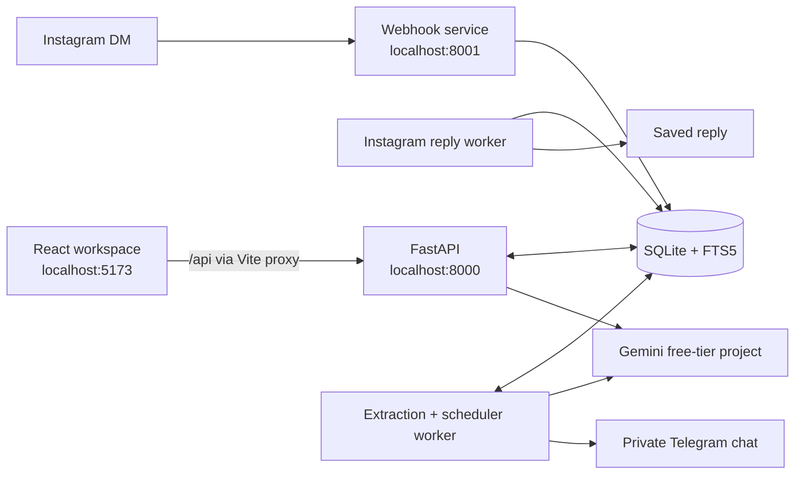

# Revero

A local-first, single-user workspace for the Reels you save: share a Reel to a dedicated Instagram account, get a durable **Saved** reply, and keep a searchable library of sourced takeaways, timestamped walkthroughs, trackable actions, and a nightly Telegram digest. Built to run on your own machine with no paid services.

> **Status:** The runtime MVP is built end-to-end and verified locally on 2026-11-15 (129 backend tests, 11 browser tests, production build). Live Instagram intake and caption extraction are accepted on 13 real shares. Live Ask is accepted for cited answers and no-match retrieval, and live Telegram delivery is accepted for manual and scheduled digests. Real-Reel video analysis, real actions/deadlines, and the Ask decline path remain unverified live; evaluation evidence and a live demo are still pending. See [Status and limitations](#status-and-limitations). The DM webhook supplies permalinks, not playable media.

## Features

- **Instagram DM intake** — signed webhook, exact raw-body HMAC verification, replay deduplication, atomic intake, and a durable `Saved` outbox with retry and uncertainty handling.
- **Sourced takeaways** — Gemini structured output validated locally with Pydantic: summary, topics, actionable suggestions, verbatim date mentions, source excerpts, and uncertainties.
- **Timestamped walkthroughs** — ordered steps with start/end seconds, spoken text, on-screen text, and validated duration bounds for instructional videos.
- **Automatic caption jobs** — titled DM shares are queued as caption-only jobs, backfilled on worker start, cached by content revision, batched, and drained under a persistent free-tier token bucket.
- **Track actions** — turn a suggestion into an action, confirm or correct a due date, and mark it done or dismissed. Evidence is snapshotted.
- **Ask your saves** — SQLite FTS5 retrieval with evidence-bound Gemini answers and validated citation IDs. Unsupported questions return a clear no-match response.
- **Nightly digest** — deterministic ranking, confirmed deadlines independent of ranking, pending-content count, and Telegram delivery with duplicate/uncertainty controls.
- **Manual fallback** — paste a Reel URL or attach a caption/clip when the link alone provides no readable content. Revero never scrapes Instagram or treats embed HTML as a transcript.

## Architecture



All services bind to localhost. Only the webhook service is exposed to Meta, through an HTTPS tunnel. Provider keys stay in the ignored root `.env`; the SQLite database, local reports, and demo artifacts are excluded from Git.

## Tech stack

| Layer | Choice |
| --- | --- |
| Web | React 19 + Vite 6 |
| API | FastAPI + Uvicorn |
| Storage/search | SQLite + FTS5 |
| AI | Google Gemini free tier, billing disabled (HTTP, no SDK) |
| Jobs | SQLite job table, Python worker, timezone-aware scheduler |
| Delivery | Telegram Bot API |
| Tests | pytest, Playwright |

## Quick start

Prerequisites: Python 3.14, Node 22, and `ffmpeg`/`ffprobe` on your `PATH`.

```sh
python3 -m venv backend/.venv
backend/.venv/bin/python -m pip install -r backend/requirements-dev.txt
npm install --prefix frontend
```

Create the ignored environment file from the placeholder example, then fill in only what you need:

```sh
cp .env.example .env
chmod 600 .env
```

Run each service in its own terminal from the repository root:

```sh
# Private workspace API
backend/.venv/bin/python -m uvicorn app.main:app --app-dir backend --host 127.0.0.1 --port 8000

# Web workspace: http://127.0.0.1:5173
npm run dev --prefix frontend

# Webhook-only service (expose only this port through your tunnel)
backend/.venv/bin/python -m uvicorn app.instagram_webhook:app --app-dir backend --host 127.0.0.1 --port 8001

# Extraction + nightly digest scheduler
PYTHONPATH=backend backend/.venv/bin/python -m app.worker

# Instagram Saved replies only (enabled after configuring a test sender)
PYTHONPATH=backend backend/.venv/bin/python -m app.instagram_worker
```

All services default to `backend/data/revero.sqlite3`. Set the same absolute `REVERO_DB_PATH` in every terminal to use another database. See [Instagram intake setup](docs/instagram-intake.md) for Meta app configuration, tunneling, and acceptance steps.

The full flow needs the API, frontend, webhook service, extraction/scheduler worker, Instagram reply worker, and tunnel running together. There is no auto-start after a reboot, and a Quick Tunnel gets a new public hostname when restarted, so the Meta callback must be updated. Keep the machine awake if you rely on the 23:00 digest.

## Configuration

Copy `.env.example` to `.env`; never commit real values.

| Variable | Purpose |
| --- | --- |
| `GEMINI_API_KEY` | Google AI Studio key for a billing-disabled project |
| `GEMINI_MODEL` | An available model that supports structured output and video |
| `GEMINI_FREE_TIER_CONFIRMED` | Local safeguard; set `true` only after confirming billing is disabled |
| `GEMINI_RPM`, `GEMINI_RPD` | Persistent token-bucket minute and day limits |
| `GEMINI_BATCH_SIZE` | Caption jobs per model request |
| `GEMINI_MAX_ATTEMPTS` | Retry attempts before a job is marked failed |
| `TELEGRAM_BOT_TOKEN`, `TELEGRAM_CHAT_ID` | Private bot delivery |
| `INSTAGRAM_APP_SECRET`, `INSTAGRAM_VERIFY_TOKEN` | Webhook signature and handshake |
| `INSTAGRAM_ACCOUNT_ID`, `INSTAGRAM_SENDER_ID` | Receiving account and enrolled test sender |
| `INSTAGRAM_ACCESS_TOKEN`, `INSTAGRAM_API_VERSION` | Send API credentials |
| `INSTAGRAM_REPLIES_ENABLED` | Enables the Saved reply worker |
| `INSTAGRAM_LOGIN_FLOW` | `unified` for `graph.facebook.com` or `instagram` for `graph.instagram.com` |

Shell environment variables take precedence over `.env`. Unset any exported values before starting services. The observed free-tier limit was **20 requests per day per model**; keep `GEMINI_RPD` at or below your model's actual limit. The current limiter counts jobs rather than batched HTTP requests, so batching does not increase the local daily job budget.

## How it works

1. **Intake** verifies the webhook signature before parsing bounded JSON, scopes events to the receiving account and enrolled sender, and commits the inbound message, saved reference, and outbox row atomically.
2. **Queueing** creates a deduplicated caption job from a share title. A worker-start backfill covers shares that arrived before processing was configured.
3. **Processing** claims jobs under a lease, consumes tokens from the persisted free-tier bucket, batches caption-only jobs, and sends inline video for single jobs. Temp files are deleted after each provider call.
4. **Validation** rejects invented caption excerpts, caption timestamps, invalid source indices, out-of-range video timestamps, and date wording that is not in the source. Relative dates are preserved verbatim; no deadline is inferred.
5. **Retry** uses exponential backoff with jitter, honors `Retry-After`, briefly circuit-breaks the queue on 429s, and falls back to isolated calls when a batch result is misordered or invalid.
6. **Use** the workspace to inspect evidence, track actions, ask questions against indexed excerpts, and preview or send the digest.

## API

| Area | Endpoints |
| --- | --- |
| Reels | `POST /api/reels`, `GET /api/reels` |
| Content | `GET/POST /api/reels/{id}/content`, `POST /api/reels/{id}/retry`, `POST /api/reels/{id}/process` |
| Config | `GET /api/processing` |
| Actions | `POST /api/actions`, `GET /api/actions`, `PATCH /api/actions/{id}` |
| Search/Ask | `GET /api/search?q=...`, `POST /api/ask` |
| Digest | `GET /api/digest`, `PUT /api/digest/preferences`, `POST /api/digest/send`, `POST /api/digest/YYYY-MM-DD/resolve` |
| Webhook | `GET/POST /webhooks/instagram` (separate service on port 8001) |

Interactive API docs are available at `http://127.0.0.1:8000/docs` while the private API runs.

## Testing

```sh
backend/.venv/bin/python -m pytest backend/tests -q

cd frontend
npx playwright install chromium
npx playwright test
npm run build
```

Backend tests use temporary databases and injected providers; browser tests use an ignored database on API port 8002 and never call real providers. The suite covers intake signatures and replays, extraction and validation, batching and rate limits, retry/lease recovery, actions, search, digest scheduling, delivery uncertainty, migration, and cleanup.

To reproduce the authored integration benchmark without spending provider quota:

```sh
backend/.venv/bin/python -m evaluation.benchmark
```

It writes ignored reports under `evaluation/results/` and does not read the personal database.

## Data, privacy, and security

- Captions and clips are sent to Google when processing starts. Free-tier inputs may be used by Google to improve its products. Videos are sent inline; no Files API upload is used.
- Provider keys and tokens live only in the ignored `.env`. The SQLite database (including temporarily stored uploads), local evaluation reports, and demo artifacts are also ignored.
- There is no delete/export UI yet, so back up `backend/data/revero.sqlite3` manually if the library matters to you.
- The webhook service verifies the exact raw-body HMAC signature and should be the only service exposed through a tunnel.
- Revero does not download Instagram media or bypass login/DRM gates. Full video analysis requires a user-supplied clip.
- Logs avoid provider payloads and credentials; Telegram request tracing is suppressed for credential-bearing URLs.

## Project structure

```text
backend/
  app/            FastAPI apps, intake, extraction, actions, search, digest, workers
  tests/          pytest suite and fixtures
  data/           ignored local SQLite database
frontend/
  src/            React workspace
  tests/          Playwright end-to-end tests
evaluation/       synthetic benchmark, fixtures, and milestone-2 sample record
docs/             setup, evaluation, and demo guides
project.md        product scope and working order
```

## Status and limitations

### Verified live (2026-11-15)

- Instagram intake and Saved replies accepted on 13 real shares.
- Caption extraction: 13/13 real shares produced validated caption-only takeaways that survived a restart.
- Ask: two real questions returned cited answers whose source IDs matched supplied excerpts; an unrelated question returned no-match with zero sources and no provider call.
- Telegram: a manual digest delivered, replaying the same request sent nothing new, a scheduled digest delivered once, and a worker restart did not resend.
- Link-only Reels: 0/13 exposed playable media through the DM webhook. Upload or caption remains the full-video path.

### Implemented but not verified live

- Real tutorial walkthrough: only an authored clip was tested; ordered real steps and timestamp quality are unmeasured.
- Actions and deadlines: automated/browser coverage only; no real action has reached a digest.
- Ask decline-with-evidence: blocked by free-tier quota; automated tests cover the empty-claims path.
- Digest with confirmed deadlines and an unattended 23:00 run; delivery uncertainty and crash recovery remain automated-test-only.

### Evaluation and demo

- `evaluation/local/real-review.json` still needs the real sample labels, and the seven-day journal has 0/7 days.
- The synthetic benchmark and offline demo exist, but the live aggregate report and live two-minute demo are pending.

### Operational and product constraints

- Single-user local pilot. M1 adds a private API password for the deployment topology; there is no multi-tenant isolation or onboarding.
- No delete/export UI. M1 adds encrypted scheduled backups with optional verified S3-compatible upload; configure independent storage and verify a remote restore before relying on it. Until then, retain a separate manual backup.
- Digest picks only Reels created on the current India-local day. A day without new saves produces an empty digest.
- Free-tier quota is small and model-specific (20 requests/day per model observed). Current quota handling can mark jobs failed after retries when the daily cap is exhausted; select another model if needed. An exported `GEMINI_MODEL` overrides `.env`.
- Retrieval is lexical (FTS5), not semantic. Check model output against cited excerpts.

## Documentation

- [Instagram intake setup and acceptance](docs/instagram-intake.md)
- [Evaluation guide](docs/evaluation.md)
- [Demo recording guide](docs/demo.md)
- [Milestone 2 real-sample record](evaluation/milestone-2.md)
- [Product scope and milestones](project.md)

## License

MIT. See [LICENSE](LICENSE).
