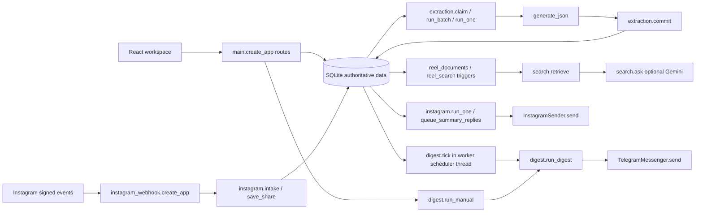

# M0 — Executable baseline audit

Audit date: **16 November 2026**. Owner: single private owner. Target: M0 review on this date.

Selected commit: **`ba738180c3714eba732e4f46ace7086ca992cfd8`**, branch `main` (`ba73818 update README with current status and operations`). Application files were clean at audit start; the root roadmap was untracked. Earlier session test counts and provider observations are historical, not the evidence for this baseline.

Source of truth: [`../single-user-mvp-roadmap.md`](../single-user-mvp-roadmap.md). The requested `docs/single-user-mvp-roadmap.md` does not exist. The root document was read in full and left in place, without creating a second competing copy. Its §11 item 5 (implement migrations) belongs to M1 under the user's explicit milestone gate; it was **not** executed during M0.

**Status: ready for owner review.** Reproducible test/build evidence and source audit are complete. Architecture proposals and external-account details remain open below. This is neither a production-readiness claim nor approval to start M1.

## Scope and data preservation

Changes are confined to this report and `docs/m0/` audit artifacts. No application source, dependency manifest, configuration, worker scheduling, personal DB rows/schema, credentials, or provider subscriptions were changed. The personal DB was opened with SQLite URI `mode=ro`, selecting schema and aggregate counts only. Temporary DBs reproduced upgrade failures. No provider inference, DM, Telegram message, account API smoke test, purchase, deployment, or backup action was performed. Tests use temporary or ignored `.e2e` data; browser reports/build output are generated ignored artifacts.

Supporting evidence:

- [Machine-readable runtime, lock hashes, schema columns, aggregates and probes](m0/evidence.json).
- [Temporary-database reproduction script](m0/reproduce-probes.py).
- [Prioritized defect register](m0/defect-register.md).
- [Architecture decision records for review](m0/architecture-decisions.md).

## 1. Executable environment and dependencies

| Item | Observed |
|---|---|
| OS/runtime environment | Local macOS workspace; zsh; project root `/Users/tousifazam/Documents/DEV/revero-app` |
| Python | Shell and `backend/.venv`: 3.14.3 |
| SQLite | Python SQLite 3.51.3 |
| Node / npm | 22.22.2 / 10.9.7 |
| Backend | FastAPI 0.162.7, Uvicorn 0.54.0, HTTPX 0.28.1, pytest 9.2.0, python-dotenv 1.2.4, python-multipart 0.0.33 |
| Frontend installed | React / React DOM 19.3.1, Vite 6.4.6, Playwright 1.65.1 |
| Dependency evidence | `backend/requirements-lock.txt`, `frontend/package-lock.json`; SHA-256 recorded in evidence JSON |
| Lock drift | All installed packages named by the backend lock match its versions. `pip check`: no broken requirements. `npm ls --depth=0`: exits 0. |
| Media tools | Local `/opt/homebrew/bin/ffmpeg` and `ffprobe`; optional uploaded-video path depends on these. |

`requirements.txt` and `requirements-dev.txt` contain ranges; use the lock snapshot for reconstructing this environment. The backend lock is an environment snapshot, not a cross-platform hash-verified lock. A clean Linux installation and Chromium system dependency installation were **not** performed. Existing installed dependencies were used; do not confuse this with deployment reproducibility already being solved.

Fresh-environment reproduction recipe (not installed over the personal environment during audit):

```sh
python3 -m venv /tmp/revero-m0-venv
/tmp/revero-m0-venv/bin/python -m pip install -r backend/requirements-lock.txt
npm ci --prefix frontend
npx --prefix frontend playwright install chromium
```

Run these from the repository root, with the documented Python/Node versions. Substitute the scratch Python for `backend/.venv/bin/python` where needed. A Linux host may additionally need Playwright's OS dependencies; that host setup is M1.

### Executed checks

| Command/check | Result |
|---|---|
| Credential-disabled backend command below | **129 passed**, exit 0, 4.72s |
| Browser command below | **11 passed**, exit 0, 18.4s |
| `npm run build --prefix frontend` | **Passed**, exit 0; Vite 6.4.6, 28 modules |
| `backend/.venv/bin/python -m pip check` | Passed; cache-permission warning, no broken requirements |
| `npm ls --prefix frontend --depth=0` | Passed |
| Lock metadata comparison | No backend version mismatches |
| Read-only personal DB FK check | 0 violations at observation time; does not prove every app connection enables FK enforcement |
| Temporary schema/connection probes | Confirmed D01–D03 in defect register |

Commands actually used:

```sh
GEMINI_API_KEY='' GEMINI_FREE_TIER_CONFIRMED=false TELEGRAM_BOT_TOKEN='' TELEGRAM_CHAT_ID='' INSTAGRAM_ACCESS_TOKEN='' backend/.venv/bin/python -m pytest backend/tests -q
GEMINI_API_KEY='' GEMINI_FREE_TIER_CONFIRMED=false TELEGRAM_BOT_TOKEN='' TELEGRAM_CHAT_ID='' INSTAGRAM_ACCESS_TOKEN='' npm run test:e2e --prefix frontend
npm run build --prefix frontend
PYTHONPATH=backend backend/.venv/bin/python docs/m0/reproduce-probes.py
```

The initial browser attempt failed before tests because the sandbox prohibited binding localhost:8002 (`operation not permitted`). The authorized retry outside that restriction passed. No source change was made to hide or bypass a failing test. One backend warning remains: Starlette deprecates HTTPX use with TestClient; Node also reports NO_COLOR/FORCE_COLOR precedence in browser execution. These do not fail the suites.

Playwright config starts a private test API on **8002** and Vite on **5174**, using ignored `frontend/.e2e/revero.sqlite3`, injected fixtures, and disabled real providers. `REVERO_TEST_API_PORT` changes the API port. Do not reuse a personal API as the test server. `reuseExistingServer=false` prevents that shortcut.

### Existing startup commands (inventory, not launched in M0)

Run from the root, in separate terminals:

```sh
backend/.venv/bin/python -m uvicorn app.main:app --app-dir backend --host 127.0.0.1 --port 8000 --no-access-log
npm run dev --prefix frontend
backend/.venv/bin/python -m uvicorn app.instagram_webhook:app --app-dir backend --host 127.0.0.1 --port 8001 --no-access-log
PYTHONPATH=backend backend/.venv/bin/python -m app.instagram_worker
PYTHONPATH=backend backend/.venv/bin/python -m app.worker
cloudflared tunnel --url http://127.0.0.1:8001
```

The last general worker command can backfill titles, call Gemini, and schedule Telegram delivery; **do not run it incidentally as an audit/health check**. Instagram worker can send acknowledgments and summaries when enabled. The Quick Tunnel is an existing development option, not a stable production callback or private-access solution. `.env` is root-local and ignored. `REVERO_DB_PATH` is read directly from process environment at import; it is not loaded from `.env` by `main.DEFAULT_DB`. Without it, storage is `backend/data/revero.sqlite3`, independent of working directory.

## 2. Dependency and state map



| Boundary | Actual entry/functions | Data/transaction behavior |
|---|---|---|
| Web save | `main.canonicalize`, nested `save_reel` | Strict HTTPS Reel URL, unique shortcode, parameterized insert; no shared library service yet |
| Signed DM | `instagram_webhook.create_app` GET/POST | Plain-text challenge, raw-body HMAC before JSON, 1 MiB cap, docs/API absent from public entry point |
| DM normalization | `instagram.intake`, `save_share` | `BEGIN IMMEDIATE`: account/message event uniqueness, provider/permalink save deduplication, reference/title provenance, caption enqueue and acknowledgment intent commit together |
| Local caption/video | `main.add_content`, `extraction.attach/enqueue` | 20k caption / 10 MiB upload limits; SHA-256 revision uniqueness; latest active revision pointer |
| Processing | `claim`, `run_batch`, `run_one`, `process_job`, `validate_result`, `commit` | Claims/lease and local counters commit before HTTP; output validated and lease-fenced; batches isolate invalid responses via fallback |
| Search | `search.initialize`, `retrieve`, `ask` | FTS5 porter/unicode61, query-term OR matching, bm25, max 5 records/8 excerpts; optional generated response validates known source IDs |
| Scheduling | `worker.main.schedule` → `digest.tick` | Separate thread, 10-second polling; rereads saved enabled/time per tick, Asia/Kolkata |
| Delivery | `run_digest`, `run_manual`, `messages`, `TelegramMessenger.send` | Frozen snapshots, multipart progress, daily scheduled identity, distinct manual identities, lease/attempt fencing and uncertainty review |
| Instagram replies | `instagram_worker.main` → `instagram.run_one` | Account/sender enrollment, Saved and generated-summary outbox kinds, 24-hour expiry, 120-second sending lease, four-attempt limit |

### Authoritative table and state inventory

Full observed columns are in `m0/evidence.json`; FTS5 internal tables are derived implementation details.

| Tables | Keys / persisted states |
|---|---|
| `reels` | ID; unique shortcode; canonical URL may be empty for provider-only records; status needs_content / queued / processing / ready / failed; active_job pointer |
| `extraction_jobs` | ID, reel/revision unique; queued / processing / ready / failed; attempts, eligible time, lease, priority, caption/media/result/error |
| `extraction_rate` | Singleton persistent token bucket and UTC day count |
| `worker_state` | Key/value `quota_until` shared cooldown |
| `actions` | ID, unique job/suggestion index; open / done / dismissed; evidence snapshots and optional user-confirmed date |
| `digest_preferences` | Singleton interests, enabled, delivery_time; timezone fixed in code |
| `digest_runs`, `digest_messages` | Scheduled date primary key; pending / sending / failed / uncertain / sent; multipart positions and Telegram message IDs |
| `digest_manual_runs`, `digest_manual_messages`, `digest_manual_requests` | Opaque run key stored in local_date column, client request aliases, same delivery state machine; distinct from scheduled rows |
| `instagram_senders` | Receiving account/sender key; bootstrap candidates only, not an authenticated UI-owner table |
| `instagram_inbound` | Unique receiving account/message identity; sender and event time, text/reel kind; plain message text not retained |
| `instagram_refs`, `instagram_shares` | Account/provider-or-permalink identity; event attachment position; provider ID/reference/title, access_class (currently unmeasured in observed data) |
| `instagram_outbox` | Fresh schema unique inbound/kind; saved/summary kinds; queued / sending / sent / failed / uncertain / expired |
| `reel_search`, `reel_documents`, triggers | Rebuildable FTS table/view and derived shadow tables; view definition can remain old on upgrade |

There is no explicit schema migration/version history, provider attempt/token ledger, notes table, Telegram ingestion offset, ownership mapping for private API requests, backup catalog, embeddings, feedback/snooze records, or export/delete workflow in the tracked source tree. `PRAGMA user_version` is 0 on the observed personal DB; this is not itself a substitute for a migration-history audit.

### Claims, external calls and recovery

- `extraction.claim` uses `BEGIN IMMEDIATE`, reclaims five-minute expired leases and increments attempts before returning. HTTP occurs after connection scope closes. `commit` conditions on processing state and the claimed lease timestamp. Single and batch failures use bounded exponential backoff with jitter; quota waits still count toward terminal attempts. No stable per-call usage ledger exists.
- Persistent limits default to 10 RPM, 250 RPD, batch 5, four attempts. `take_tokens` consumes one token **per job**, not per batch HTTP request; fallback requests are not individually reserved. Daily counter uses UTC, not Pacific. Ask calls `generate_json` without these reservations, though it checks shared cooldown. Thus the current feature is an extraction throttle, not a complete provider-budget gateway.
- `/process` clears per-job backoff/attempts and priority but claim still checks local bucket and global cooldown. This can repeatedly reset a terminal failure; there is no durable cancel/blocked/deferred state contract yet.
- Scheduled and manual digest claim/progress transactions end before Telegram HTTP. Confirmed parts retain IDs; stale or ambiguous sends become uncertain. Manual active/uncertain run reuse and client request aliases provide duplicate protection. No ordinary delivery is truly externally exactly-once.
- `digest.tick` reads settings on each call; same-date catch-up occurs after saved time; no earlier-date replay. Changing time cannot repeat a sent scheduled date. Current eligibility is **today's saves only**; no empty skipped-run behavior, grace window, feedback, snooze, cooldown, or library-wide selection exists.
- One general-worker process owns one scheduler thread. No host-level leader election/supervisor prevents starting multiple schedulers; SQLite run claims mitigate duplicate delivery but do not provide singleton process ownership. Instagram has a separate reply-only process. Telegram has no ingestion consumer yet (`telegram_setup` only reads chat IDs).
- `instagram.run_one` queues summaries, claims a job, closes its transaction, then calls the Send API. Provider-only refs never become video evidence automatically. On fresh schema the Saved and summary jobs coexist; legacy inline uniqueness is broken (D02).
- Startup initialization runs schema inspection/ALTER and rebuilds FTS. Instagram initialization uses `executescript`, so it is not a versioned all-or-nothing migration scheme. No inspected normal provider send occurs inside a DB write transaction.

## 3. Environment inventory — names and purposes only

No credential values, IDs, URLs containing credentials, prompts, personal captions, or notes are copied into this report.

| Names | Purpose / loading |
|---|---|
| `REVERO_DB_PATH` | Process-environment DB override, import-time resolution |
| `GEMINI_API_KEY`, `GEMINI_MODEL`, `GEMINI_FREE_TIER_CONFIRMED` | Backend credential/model/explicit free-tier confirmation; `.env` plus environment overrides |
| `GEMINI_RPM`, `GEMINI_RPD`, `GEMINI_BATCH_SIZE`, `GEMINI_MAX_ATTEMPTS` | Extraction throttle/retry settings, reread by worker; local defaults are not verified account quotas |
| `INSTAGRAM_APP_SECRET`, `INSTAGRAM_VERIFY_TOKEN` | Signed POST validation and GET challenge; webhook captures settings at app creation |
| `INSTAGRAM_ACCOUNT_ID`, `INSTAGRAM_SENDER_ID` | Enrolled receiver and sender scope |
| `INSTAGRAM_ACCESS_TOKEN`, `INSTAGRAM_API_VERSION`, `INSTAGRAM_LOGIN_FLOW` | Provider credential/version and fixed-host selection (Unified vs legacy Instagram Login) |
| `INSTAGRAM_REPLIES_ENABLED` | Explicit outbound reply switch; reply worker reloads configuration |
| `TELEGRAM_BOT_TOKEN`, `TELEGRAM_CHAT_ID` | Delivery token and numeric private-chat destination; backend reloads configuration |
| `REVERO_API_TARGET`, `REVERO_WEB_PORT` | Vite development proxy and port |
| `REVERO_TEST_API_PORT` | Isolated Playwright API port |
| `REVERO_DEMO_DB` | Isolated demo app DB guard |
| `CI` | Tooling/environment convention, not proof that CI is configured |

Tracked `.env.example` is an example; actual `.env`, data, `.e2e`, artifacts and private evaluation files are ignored. `git ls-files` confirms `.env` and personal DB files are not tracked. This does **not** certify all Git history or guarantee previous exposed credentials were rotated. No credential scan that prints secret matches was run.

## 4. Current search and real-share facts

Source `search.DOCUMENTS` includes the active caption, summary, topics, suggestion text, evidence excerpts and walkthrough instruction/spoken/on-screen text. It does not index raw DM titles without an active extraction job, user notes, explicit date windows, or action status. Titles now enter caption jobs through `instagram.intake` and `extraction.backfill_titles`; they are not guaranteed complete transcripts or captions. Lexical `/api/search` does not call Gemini. `/api/ask` may call Gemini after retrieval. There are no date/topic/action filter parameters or vector indexes.

**Upgrade divergence:** the personal DB's `reel_documents` definition does not contain walkthrough fields. `CREATE VIEW IF NOT EXISTS` preserves older definitions, so current Python source alone overstates what this installed DB indexes. A temporary old-view probe confirmed it. Walkthrough matches can also return generic source excerpts rather than the matching step because `retrieve` renders only sources/caption windows.

Read-only aggregate snapshot (not a new provider accuracy study):

- 15 saves: 13 ready, 2 needs_content; 13 extraction jobs ready.
- 13 shared events / 13 distinct shared Reels; each has provider ID, reference and title.
- All 13 references are hosted at `www.instagram.com`; no direct playable-video conclusion follows.
- DB journal mode is delete; no existing FK violations detected. Live view remains old.

Prior live onboarding established user-confirmed Instagram Saved delivery and later README claims live Ask/Telegram acceptance. These were **not repeated during M0** and must not be reported as fresh provider tests. The prior 12-sample report is a historical direct-reference experiment, not evidence of broad authorized-media availability or Gemini video quality. Automatic video acquisition is explicitly deferred by this roadmap; M0 does not pursue it.

## 5. Official dependency and cost verification

Verified against public official pages on **2026-11-16**. These checks verify published rules, not the owner's private dashboard quotas, granted app access, billing status, checkout totals, or regional availability.

| Area | Current finding and source |
|---|---|
| Meta permissions | Unified Login uses `instagram_basic` and `instagram_manage_messages` for the relevant profile/messaging capabilities, with Standard/Advanced access dependent on use and roles. [Unified Login permissions](https://developers.facebook.com/documentation/instagram-platform/instagram-api-with-unified-login/permissions). |
| Meta webhook setup | App field subscription and professional-account subscription are separate. Unified Login uses the system-user token on graph.facebook.com; production/access and live-publication requirements must be checked for the actual app. [Webhook setup](https://developers.facebook.com/documentation/instagram-platform/webhooks/setup). |
| Telegram message limits | `sendMessage` text is 1–4096 characters after entity parsing. Existing code chunks conservatively by UTF-16 size. [Bot API](https://core.telegram.org/bots/api#sendmessage). |
| Telegram throughput/cost | FAQ advises roughly one message/second per private chat; exceeding limits may yield 429. Paid broadcasts are opt-in; MVP must leave them off. [Bots FAQ](https://core.telegram.org/bots/faq). Existing pagination has no explicit one-second pacing. |
| Gemini quota scope | RPM, input TPM, RPD; limits apply per project, RPD resets at midnight Pacific. Actual active limits depend on model/tier and must be read from AI Studio; no universal numeric free quota is asserted. [Rate limits](https://ai.google.dev/gemini-api/docs/rate-limits). |
| Gemini data terms | Unpaid inputs/outputs may improve Google products and be human-reviewed; sensitive/confidential/personal information should not be submitted. Regional exceptions exist. Actual account treatment must be checked before private use. [Terms](https://ai.google.dev/gemini-api/terms). |
| Gemini pricing/budget | Free availability varies by model/feature; no paid inference is authorized by this audit. The confirmation flag does not inspect Cloud billing. [Pricing](https://ai.google.dev/gemini-api/docs/pricing). |
| Hosting candidate A | Hetzner's 2026 adjustment lists CX23 €5.49/month and CX33 €8.49/month in Germany/Finland, **excluding IPv4 and VAT**. These are server-only candidates, not total INR quotes. [Official price adjustment](https://docs.hetzner.com/general/infrastructure-and-availability/price-adjustment/) and [current cloud calculator](https://www.hetzner.com/cloud/). |
| Hosting candidate B / backup | DigitalOcean provides alternative VM sizing and hourly/monthly pricing; regional plan/backup choices need a checkout quote. Backblaze B2 is an off-host object-storage candidate; usage, region, request/transfer charges and minimum terms need confirmation. [DigitalOcean pricing](https://www.digitalocean.com/pricing/droplets), [B2 pricing](https://www.backblaze.com/cloud-storage/pricing). No account was opened and no storage was ordered. |

INR 1,000–2,500/month remains the roadmap's planning envelope, not an approved purchase or verified total. Provider/region, tax, exchange rate, IPv4, persistent disk, backup size/retention and private-access cost must be included before approval. Embedding-model peak memory has not been measured; 2 vCPU / 4 GB is a candidate sizing assumption, not a capacity result.

## 6. Exit review and boundaries

- [x] Selected commit, runtime, locks and startup inventory recorded.
- [x] Source-based functions/tables/states and transaction map recorded.
- [x] Quota/retry/scheduler behavior inspected rather than inferred from README.
- [x] Environment names documented without secret values.
- [x] Actual index definition and real-share metadata checked read-only.
- [x] Backend/browser/build rerun; sandbox failure and warnings explained.
- [x] Prioritized defects include evidence, reproduction and future acceptance checks.
- [x] Official dependency rules and hosting candidates checked, dated and linked.
- [x] Short architecture records prepared with status and approval gates.
- [ ] Owner accepts the audit and resolves or explicitly defers the listed architecture choices.

No M1 work has started: no ordered migrations, WAL changes, containers, VPN, backup automation, restore actions or CI were added. Next milestone can begin only after explicit user approval. M1 must preserve existing saves, summaries, acknowledged/sent IDs, frozen digest snapshots and uncertainty states while repairing legacy upgrades.
