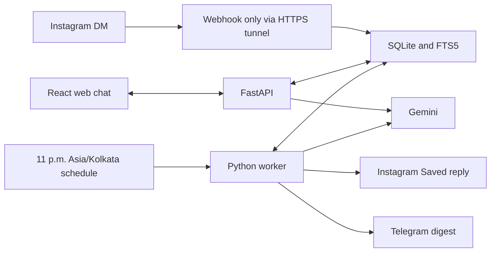

# Revero

Revero receives Instagram Reel shares in DMs to a dedicated professional account and replies Saved. The private local web app is the workspace for searchable, timestamped video walkthroughs, questions, and actions. Manual Reel URL entry and local captions/uploads remain fallbacks. Get a ranked daily digest at 11 p.m. IST. Build it locally as a single-user project with no paid dependencies.

## What v1 does

- Share a Reel to Revero in Instagram DMs, receive Saved, and see one durable inbox item. Keep canonical manual URL intake as a fallback.
- Analyze readable full videos into ordered, searchable walkthrough segments with start/end timestamps, spoken instructions, on-screen text, and source evidence. Mark unreadable or uncertain values explicitly; retain a short takeaway for digests.
- Answer questions such as “What did I save about backend interviews?” with links to supporting Reels.
- Let you track a suggested action, confirm or correct a due date, and mark it done or dismiss it.
- Send up to three useful Reels, upcoming tracked deadlines, and a count of links needing content in a nightly Telegram digest.

Telegram is the default delivery channel for the zero-cost build. WhatsApp is an optional adapter because scheduled template delivery can incur charges. Calendar sync follows the working action list. A downloadable calendar file is a simple first extension.

## Stack and architecture

| Layer | Choice |
|---|---|
| Web chat | React + Vite |
| API | Separate webhook-only FastAPI service; private local FastAPI workspace |
| Storage and search | SQLite + FTS5 |
| AI | Gemini free-tier project with billing disabled. Use a model available to your account that supports the inputs you test. |
| Jobs | SQLite job table, a Python worker, and a timezone-aware digest check |
| Delivery | Telegram Bot API |
| Runtime | Your computer during development and for nightly delivery |



Use the FastAPI service for saving, asking, and managing actions. The worker handles slow processing and digests. Keep provider keys server-side in an ignored environment file. Commit an example environment file with placeholders. Bind development services to localhost and keep the real database, uploads, and credentials out of Git.

Suggested layout:

```text
project.md
backend/
  app/
  tests/
  requirements.txt
frontend/
  src/
.env.example
.gitignore
```

## 1. Instagram DM intake — current milestone

Follow `instagram-webhook-plan.md` and `docs/instagram-intake.md`. The local implementation is available; live account acceptance is pending.

1. Run a webhook-only FastAPI service on localhost:8001; tunnel only that port. Keep private API:8000 and React:5173 local.
2. Verify the Meta challenge and exact raw-body HMAC-SHA256 signature before parsing bounded JSON. Scope intake to the configured receiving account and enrolled test sender; ignore echoes and unsupported messages.
3. Commit inbound message identity, saved Reel/reference, and durable Saved outbox job atomically. Deduplicate account/message replays and provider IDs or verified canonical URLs. Preserve provider references separately; do not invent a permalink or infer video access.
4. Use the separate acknowledgment worker for Send API calls. Persist retries, reply-window expiry, and uncertain outcomes. Review uncertain sends before any resend.
5. Verify signed fixtures and mocked Send API locally, then connect the account and jointly verify a real text DM, a share-sheet Reel, replay behavior, one reply, and local inbox persistence.
6. Measure 10–20 real shares before extending extraction. Record field availability and actually authorized video access separately. Keep reference-only saves and upload/caption fallbacks usable.

**Done when** a real enrolled sender's share yields one saved inbox item and one Saved reply, replays create neither twice, and measured media-access outcomes are documented. Local fixtures alone do not complete live acceptance. No Gemini or Telegram needed for this milestone.

## 2. Local web workspace and manual URL fallback (implemented)

1. Create a Python virtual environment in the backend and install FastAPI and Uvicorn. Scaffold a React project with Vite in the frontend. Check your installed Python and Node versions against the tools you choose.
2. Initialize SQLite on app startup. Create a `reels` table with `id`, unique `shortcode`, canonical `url`, `status`, and `created_at`. Resolve the database path independently of the shell's working directory.
3. Implement `POST /api/reels` accepting `{"url":"https://www.instagram.com/reel/AbC123/?igsh=example"}`. Parse with `urlsplit`, require HTTPS and the exact Instagram hostname, and validate the path as `/reel/<shortcode>/`, with an optional trailing slash and a case-sensitive shortcode. Strip tracking parameters by rebuilding the URL. Reject invalid links with a clear 400 response.
4. Insert using parameterized SQL and a unique constraint on the shortcode. Return the saved row and a boolean `created` so repeated submissions show “Already saved.” Set new rows to `needs_content`.
5. Implement `GET /api/reels` in insertion order. Try both endpoints in FastAPI's local `/docs` before creating the UI.
6. Configure Vite to proxy `/api` to FastAPI. Add a chat message list, input, and Send button. Load saved rows on page open. Show saved, duplicate, and error replies. Keep the input on errors and disable Send while submitting.

**Done when** a valid link saves, a tracking variant returns the same ID, an unrelated URL is rejected, and the saved Reel reappears after refreshing and restarting the backend. This milestone uses zero API keys.

## 3. Full-video timestamped walkthroughs — after live intake and media measurement

1. Let the user attach a caption or a small supported video to an existing Reel. Set upload size limits, save temporary files locally, and clean them up after processing. Keep the Reel URL regardless of whether content is available.
2. Queue a processing job and show `needs_content`, `queued`, `processing`, `ready`, or `failed` in the chat. Use a stable job identity per Reel and content revision so a retry can update the existing result.
3. Extend the existing short-takeaway extraction only after the intake gate. For each readable full clip, store ordered walkthrough segments with start/end seconds, instruction, spoken evidence, visible text/UI labels, and unknown/unreadable values. Validate monotonic timestamps against measured video duration, preserve uncertainty, and index segment text for retrieval with timestamp links or a local player seek target. Test a DaVinci Resolve tutorial by following its extracted steps. Caption-only inputs must stay labeled and must not acquire fabricated video timestamps.
4. Use one Gemini integration first. Send the supplied caption or clip and request structured output. Validate it with Pydantic before persisting anything. Store the summary, topics, suggestions, date candidates, and source references. A source reference includes an excerpt, its origin, and a timestamp when available.
5. Label caption-only results. Keep unknown dates and unsupported timestamps empty. Preserve the original wording for relative dates and resolve them only when the source supports the date.
6. Retry temporary failures with backoff. Defer jobs when the free quota is exhausted. Cache successful extractions so searching and building digests reuse them.
7. Sample 10–20 real saved Reels and record which links yield enough accessible content. Instagram's public embed endpoint returns display HTML. Keep upload or caption entry as the working path when the link alone supplies too little.

**Done when** a readable full video yields ordered searchable walkthrough segments with validated timestamps, a DaVinci Resolve tutorial can be followed from its steps, caption-only results stay labeled, an unreadable share remains saved, and a failed extraction can be retried. Gemini's free tier has limits and Google may use free-tier inputs to improve its products. For a local AI option later, evaluate FFmpeg, Whisper, and a locally runnable model.

## 4. Track what needs action

1. Create an `actions` table linked to Reels. Store the action text, optional due date, source excerpt, and status (`open`, `done`, or `dismissed`).
2. Show **Track this** beside actionable suggestions. One tap creates an open action. Repeated taps on the same suggestion return the same action.
3. Show the source wording when a date is proposed. Let the user confirm or edit ambiguous dates. Allow actions without a due date.
4. Add an **Actions** view within the chat with **Done** and **Dismiss** controls.

**Done when** a tracked action survives a restart, an unclear deadline can be corrected, and completed or dismissed items leave the active list.

## 5. Ask your saved Reels

1. Index captions, transcripts when available, and takeaways in SQLite FTS5. Update the index when an extraction changes.
2. Retrieve a small set of relevant excerpts for each question. Send them to Gemini with their source IDs and instruct it to answer from those excerpts. Validate source IDs in the response and render links from stored records.
3. Return an explicit “I couldn’t find that in your saves” when there is no supporting material. Use a few real questions to decide whether semantic search is worth adding later.

**Done when** a question finds an older relevant Reel and an unsupported question produces a clear no-match response.

## 6. Send and schedule the digest

1. Build a deterministic ranking from interest match, how concrete the takeaway is, and recency as a tie-breaker. Save the score reasons for the demo.
2. Assemble a digest with up to three ready Reels, their original links, upcoming open actions with confirmed dates, and a count of unprocessed shares. Include deadlines independently of Reel ranking.
3. Create a Telegram bot, start a private conversation with it, and configure the target chat ID and bot token on the backend. Send a test digest on demand.
4. Persist a configurable daily time and enabled flag in SQLite, defaulting to 23:00 in `Asia/Kolkata`. Read saved changes on each scheduler tick without restarting. Manual sends use separate durable request records; concurrent clicks reuse the active manual request and never consume the scheduled run. Record one digest run per local date. Mark successful sends and skip them on reruns. If a request times out after it may have reached Telegram, record it as uncertain for review before retrying so the worker minimizes duplicate sends.
5. Define restart behavior. For v1, send a missed digest on restart if it is still the same local date and the run is unsent. Keep the machine awake and online for on-time delivery.

**Done when** the scheduled digest shows expected picks and deadlines, and rerunning a completed date sends no duplicate.

## 7. Evaluate and prepare a portfolio demo

- Use Revero for a week. Record how many links supply usable material without manual input and how many need a caption or upload.
- Label a small set of Reels with expected takeaways and dates. Include on-screen text, an old relative date, a duplicate share, and an inaccessible Reel.
- Compare the top three ranked results against newest-first using your own relevance labels. Report sample size, processing coverage, and correctly extracted deadlines. Keep observable results in the README.
- Record a two-minute demo. Save a Reel, show the evidence behind its takeaway, track a deadline, ask a question that retrieves an older save, and trigger a digest.
- Add setup instructions, the architecture diagram, and a sample digest to the README. Use sample content suitable for public sharing.

## After v1

Add a calendar export for confirmed dates, then connected calendar writes if useful. Include the original Reel URL and give events a stable identity to prevent duplicates. If you still want WhatsApp delivery, add it behind the digest sender interface and check Meta's template and pricing requirements before enabling it.

## Working order

Build and verify Instagram intake first. Existing manual intake, short takeaways, actions, search, and digest code remains available, with prior local fixture verification. Their existence does not establish live Instagram media access or full-video walkthrough support. Pause after local intake checks for account configuration; extend Gemini only after actual shares have been measured. Keep the pilot local and free and never commit or log credentials.

## Integration references

- [Instagram oEmbed](https://developers.facebook.com/docs/graph-api/reference/instagram-oembed/)
- [Gemini API pricing](https://ai.google.dev/gemini-api/docs/pricing)
- [Telegram Bot API](https://core.telegram.org/bots/api)
- [WhatsApp Business Platform](https://developers.facebook.com/documentation/business-messaging/whatsapp/overview/)
